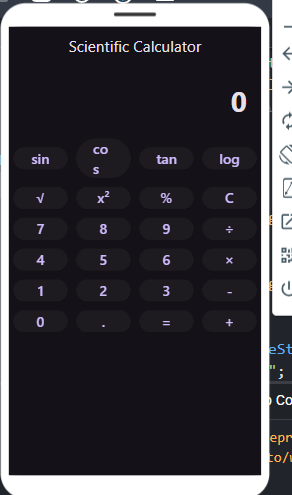

# 📦 Flutter Scientific Calculator

A modern, responsive Scientific Calculator mobile application built with **Flutter** and **Dart**. Designed with an intuitive interface, it supports a comprehensive suite of operations ranging from daily standard arithmetic to advanced mathematical calculations including trigonometry, logarithms, power exponents, and roots.

[](https://flutter.dev/)
[](https://dart.dev/)
[](https://www.android.com/)
[](https://www.apple.com/ios/)
[](https://flutter.dev/multi-platform)
[](https://choosealicense.com/)

---

## 📸 Screenshots

| Scientific Calculator UI |
|:---:|
|  |

---

## 🚀 Features

- **Standard Arithmetic Operations**:
  - Addition (`+`), Subtraction (`-`), Multiplication (`×`), and Division (`÷`).
  - Percentage calculations (`%`) and decimal point floating precision.
- **Trigonometric Calculations**:
  - Sine (`sin`), Cosine (`cos`), Tangent (`tan`).
  - Angle unit evaluation supporting degrees and radians.
- **Logarithmic & Exponential Functions**:
  - Natural logarithm (`ln`) and common base-10 logarithm (`log`).
  - Power exponents ($x^y$), square ($x^2$), and square root ($\sqrt{x}$).
  - Euler's exponential function ($e^x$) and power-of-ten ($10^x$).
- **Mathematical Constants**:
  - Direct keypad access to Pi ($\pi \approx 3.14159$) and Euler's number ($e \approx 2.71828$).
- **Expression Evaluation & Grouping**:
  - Parentheses `(` and `)` for complex compound expressions.
  - Proper mathematical order of operations (PEMDAS/BODMAS).
- **Interactive Display & State Handling**:
  - Multi-line dynamic display showing input expression alongside real-time calculated results.
  - Single-character delete / backspace (`DEL`) and full reset (`AC`).
  - Dark-themed modern UI optimized for one-handed mobile accessibility.

---

## 🛠️ Tech Stack

| Category | Technology | Description |
|---|---|---|
| **Framework** | [Flutter](https://flutter.dev/) | Cross-platform application UI SDK |
| **Language** | [Dart](https://dart.dev/) | Type-safe, object-oriented client programming language |
| **Android Layer** | Kotlin & Gradle 8.10.2 | Native Android compilation and Gradle wrapper integration |
| **iOS Layer** | Xcode / Swift / Objective-C | Native iOS runner project and configuration |
| **Linter** | Dart Analyzer | Configured via `analysis_options.yaml` for Flutter code quality |

---

## 📂 Project Structure

```text
Flutter-Scientific-Calculator/
├── android/                             # Android native host application & Gradle configuration
│   ├── app/
│   │   ├── build.gradle.kts             # App-level build scripts & Kotlin settings
│   │   └── src/main/AndroidManifest.xml # Android permissions and activity declarations
│   └── gradle/wrapper/                  # Gradle distribution wrapper (v8.10.2)
├── ios/                                 # iOS native project structure
│   ├── Runner/                          # iOS app runner, Info.plist, and asset catalogs
│   └── Runner.xcworkspace               # Xcode workspace configuration
├── lib/                                 # Core Flutter source code
│   └── main.dart                        # Application entry point, calculator UI & math logic
├── web/                                 # Web platform support files
│   ├── favicon.png
│   ├── index.html                       # Web entry point
│   └── manifest.json                    # Web app manifest
├── analysis_options.yaml                # Static analysis options and linting rules
├── output.png                           # Application interface preview screenshot
├── pubspec.yaml                         # Project dependencies, assets, and metadata
└── README.md                            # Project documentation
```

---

## 📋 Prerequisites

Before running this application locally, ensure you have installed:

- **[Flutter SDK](https://docs.flutter.dev/get-started/install)** (version `>= 3.0.0`)
- **[Dart SDK](https://dart.dev/get-dart)** (bundled automatically with Flutter)
- **[Android Studio](https://developer.android.com/studio)** or **VS Code** with Flutter & Dart extensions
- **Android SDK & Emulator** (or physical Android device with USB debugging enabled)
- **Xcode & CocoaPods** (macOS only, required for iOS simulator/devices)

Verify your development environment:
```bash
flutter doctor
```

---

## ⚙️ Installation & Setup

1. **Clone the Repository**
   ```bash
   git clone https://github.com/Happybhai329/Flutter-Scientific-Calculator.git
   cd Flutter-Scientific-Calculator
   ```

2. **Install Dependencies**
   ```bash
   flutter pub get
   ```

3. **Check Available Devices**
   ```bash
   flutter devices
   ```

---

## 🏃 Running the Application

### Run on Default Connected Device / Emulator
```bash
flutter run
```

### Run on Android
```bash
flutter run -d android
```

### Run on iOS Simulator (macOS only)
```bash
flutter run -d ios
```

### Run in Google Chrome (Web)
```bash
flutter run -d chrome
```

---

## 🏗️ Building for Production

### Android APK
```bash
flutter build apk --release
```
The resulting APK will be generated at `build/app/outputs/flutter-apk/app-release.apk`.

### Android App Bundle (Play Store)
```bash
flutter build appbundle --release
```

### iOS App
```bash
flutter build ios --release
```

### Web
```bash
flutter build web --release
```

---

## 🤝 Contributing

Contributions, issues, and feature requests are welcome!

1. Fork the repository (`https://github.com/Happybhai329/Flutter-Scientific-Calculator/fork`).
2. Create your feature branch:
   ```bash
   git checkout -b feature/AmazingFeature
   ```
3. Commit your changes:
   ```bash
   git commit -m "Add some AmazingFeature"
   ```
4. Push to the branch:
   ```bash
   git push origin feature/AmazingFeature
   ```
5. Open a Pull Request.

---

## 📄 License

This project currently has no explicit open-source license assigned. All rights are reserved by the original author. For reuse or distribution inquiries, please reach out to the repository maintainer.

---

---

## 👤 Author & Maintainer

**Happy Bhasin**  
*Full Stack & AI Engineer* | Amity University Madhya Pradesh (B.Tech CSE with Minor in AI/ML)  

- 🌐 **GitHub:** [@Happybhai329](https://github.com/Happybhai329)  
- 💼 **LinkedIn:** [Happy Bhasin](https://www.linkedin.com/in/happy-bhasin-908191267)  
- 📧 **Email:** [bhasinhappy0506@gmail.com](mailto:bhasinhappy0506@gmail.com)  
- 📱 **Phone:** +91 9220553665  
- 📍 **Location:** India (Open to Remote & Global Relocation)  

---

## 📄 License

This project is licensed under the [MIT License](LICENSE).
